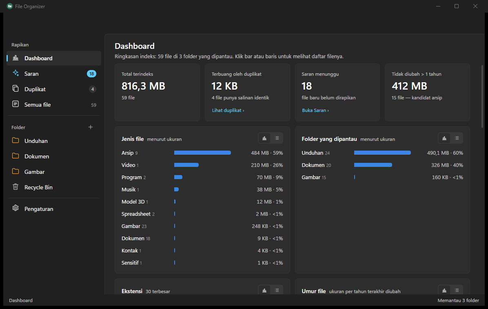
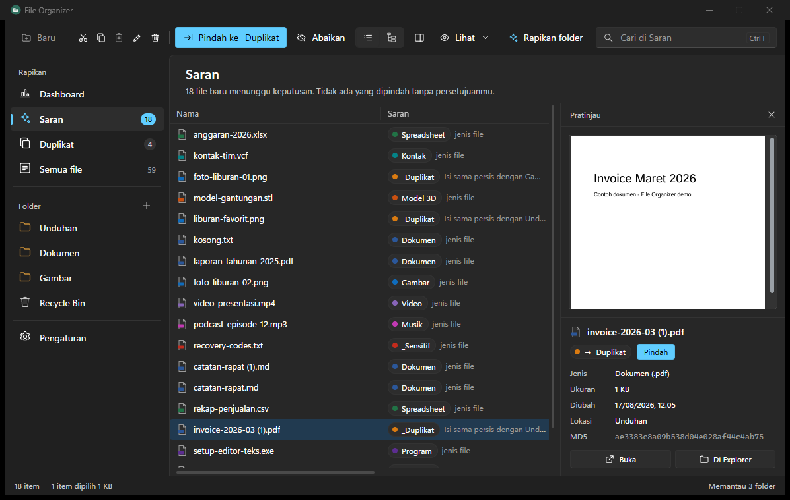
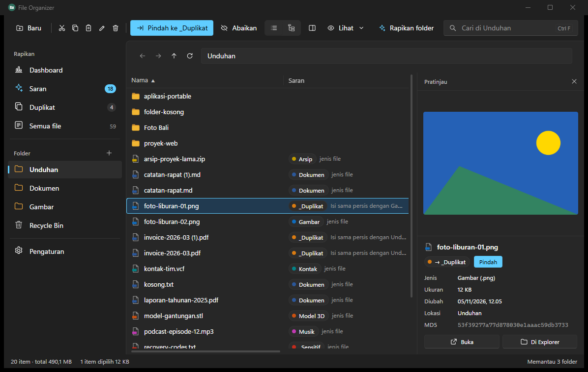
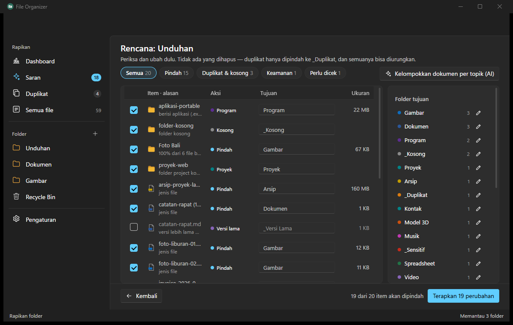
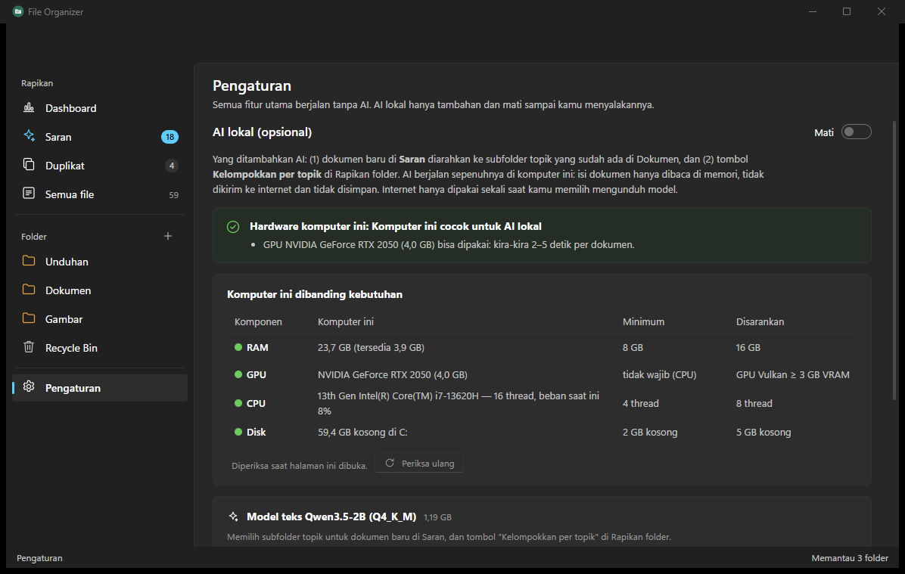

<div align="center">

# File Organizer

**Aplikasi desktop Windows yang menjaga folder tetap rapi — dan tidak pernah memindahkan file tanpa izinmu.**

[English](README.md) · **Bahasa Indonesia**



</div>

File Organizer memantau folder yang kamu pilih, menyarankan ke mana file baru sebaiknya disimpan, menemukan file
duplikat, menunjukkan ke mana ruang disk terpakai, dan mengubah folder yang berantakan menjadi rencana rapi yang bisa
kamu edit. Tidak ada yang dipindah sebelum kamu setujui, tidak ada yang dihapus diam-diam, dan setiap proses bisa
diurungkan.

Dibuat dengan [Tauri 2](https://tauri.app) dan Rust, dengan antarmuka HTML/CSS/JS tanpa dependensi yang mengikuti
tampilan Windows 11 dalam mode terang dan gelap. Antarmukanya berbahasa Indonesia.

## Sorotan

- **Menyarankan, tidak mengejutkan** — setiap pemindahan perlu diklik; tidak ada yang ditimpa; semua bisa diurungkan.
- **Duplikat berdasarkan isi** — MD5 setiap file, bukan sekadar nama yang mirip.
- **Rapikan satu folder sekaligus** — rencana yang bisa diedit dengan pratinjau langsung, diterapkan sebagai satu
  batch yang bisa diurungkan.
- **Menjelajah seperti Explorer** — daftar atau tree, panel pratinjau, potong/salin/tempel dengan File Explorer,
  drag & drop, Recycle Bin, item tersembunyi, ukuran folder.
- **Dashboard** — ke mana ruang disk terpakai, menurut jenis, ekstensi, folder, dan umur file, dengan daftar rinci.
- **AI offline opsional** — mati secara default; pemeriksaan hardware memberi tahu apakah layak dinyalakan.

## Tangkapan layar

| Saran | Menjelajah dengan pratinjau |
|---|---|
|  |  |
| **Rencana merapikan** | **Pengaturan: AI opsional** |
|  |  |

Semua tangkapan layar diambil dari data demo buatan (lihat [Tangkapan layar dan data demo](#tangkapan-layar-dan-data-demo)).

## Fitur

### Saran
File lepas yang baru muncul di folder yang dipantau mendapat tujuan sesuai jenisnya (Dokumen, Gambar, Spreadsheet,
Arsip, Program, Kode, Musik, Video, …). Nama yang terlihat rahasia (kode pemulihan, kunci, `.env`, kata sandi) diarahkan
ke `_Sensitif`, dan file yang isinya sudah ada di tempat lain diarahkan ke `_Duplikat`. Notifikasi Windows memberi
tahu saat ada saran baru.

### Folder yang dipantau
Mulai dari Desktop, Downloads, Documents, Pictures, Music, dan Videos, lalu tambahkan folder pengguna, OneDrive, drive
utuh, atau folder apa saja lewat tombol **+**. Drive yang dicolokkan langsung terdeteksi dan bisa ditambahkan dengan
satu klik; drive yang dicabut tetap menyimpan indeksnya dan diperbarui saat terhubung lagi. Folder sistem dan item
tersembunyi dilewati.

### Menjelajah
Address bar dengan kembali/maju/naik, tampilan daftar dan tree, kolom yang bisa diurutkan dan diubah lebarnya, ukuran
folder yang dihitung di latar belakang (saat diurutkan berdasarkan ukuran, folder ikut bersaing dengan ukuran
totalnya), pencarian nama atau MD5, serta panel pratinjau untuk gambar, PDF, audio, video, teks, kode, dan DOCX.

### Aksi file
Buka, ganti nama, folder baru (langsung dalam mode ganti nama), hapus ke Recycle Bin (bisa diurungkan),
potong/salin/tempel lewat clipboard Windows, drag & drop di dalam aplikasi, dari desktop, dan keluar ke aplikasi
lain, properti, serta tampilan Recycle Bin untuk memulihkan atau menghapus permanen.

### Rapikan folder
1. Centang folder yang isinya ingin dirapikan (subfolder yang tidak dicentang isinya tidak diubah).
2. Periksa rencananya: file menurut jenis, project kode → `Proyek`, folder aplikasi → `Program`, folder yang isinya
   mayoritas satu jenis, duplikat → `_Duplikat`, item kosong → `_Kosong`, file rahasia → `_Sensitif`, PHP mencurigakan
   → `_Karantina`, versi lama → `_Versi Lama` (tidak dicentang secara default), folder kategori berbahasa Inggris →
   nama Indonesia.
3. Ubah apa saja: centang/lepas, ketik tujuan (`Dokumen\Pajak`), ubah banyak baris sekaligus, ganti nama folder
   tujuan untuk semua baris. Pratinjau langsung diperbarui.
4. Terapkan — tidak ada yang dihapus atau ditimpa, dan seluruh proses bisa diurungkan.

### Dashboard
Ukuran terindeks, ruang yang terbuang oleh duplikat, saran yang menunggu, dan file yang tidak disentuh lebih dari
setahun; jenis file, folder, ekstensi, dan umur file sebagai chart (ukuran dan persentase) atau tabel yang bisa
diurutkan. Klik bar atau baris mana pun untuk melihat daftar filenya (semua `.exe`, semua video, file dari tahun
2021, …). Ditambah daftar file terbesar, duplikat paling boros, dan saran pembersihan sekali klik.

### AI lokal opsional
Menyarankan subfolder topik untuk dokumen. Berjalan sepenuhnya di komputermu (llama.cpp; GPU lewat Vulkan, dengan
cadangan CPU); teks dokumen hanya dibaca di memori. Halaman pengaturan membandingkan komputer ini (RAM, GPU/VRAM, beban
CPU, ruang disk) dengan kebutuhannya dan memberi saran; mengunduh model (≈1,2 GB, revisi tetap, dicek SHA-256, bisa
dilanjutkan) selalu menjadi pilihanmu.

## Pintasan keyboard

| Tombol | Aksi | Tombol | Aksi |
|---|---|---|---|
| Enter / klik dua kali | Buka | Ctrl+X / C / V | Potong / salin / tempel |
| F2 | Ganti nama | Ctrl+Z | Urungkan pindah atau hapus terakhir |
| Del | Hapus ke Recycle Bin | Ctrl+Shift+N | Folder baru |
| Alt+Enter | Properti | Ctrl+Shift+C | Salin path |
| Alt+P | Panel pratinjau | Ctrl+H | Tampilkan item tersembunyi |
| Alt+← / → / ↑ | Kembali / maju / naik | Ctrl+F, F5 | Cari, muat ulang |

## Keamanan file

- Hanya saran; setiap pemindahan perlu diklik.
- Tidak pernah menimpa: nama yang sudah dipakai menjadi `nama (1).ext`.
- Menghapus hanya lewat Delete yang disengaja, ke Recycle Bin (bisa diurungkan); hapus permanen selalu minta
  konfirmasi.
- Setiap batch pemindahan dicatat dan bisa diurungkan.
- File tersembunyi/sistem, project kode, dan folder dependensi (`node_modules`, `target`, …) tidak disentuh.

## Kebutuhan

| | Minimum | Disarankan |
|---|---|---|
| OS | Windows 10/11 x64 | Windows 11 |
| Tanpa AI | komputer apa pun yang menjalankan Windows 10/11 | — |
| AI: RAM | 8 GB | 16 GB |
| AI: GPU | tidak wajib (berjalan di CPU, lambat) | GPU Vulkan dengan VRAM ≥ 3 GB |
| AI: disk | 2 GB kosong | 5 GB kosong |

## Build dari source

Prasyarat: Rust (stable), Visual Studio Build Tools (C++), WebView2 runtime (sudah ada di Windows 11).

```powershell
cd src-tauri
cargo test              # tes otomatis
cargo run               # build pengembangan (tanpa mesin AI)
cargo build --release   # src-tauri\target\release\file-organizer.exe
```

Dengan mesin AI (tambahan: Vulkan SDK, LLVM/libclang, dan CMake):

```powershell
$env:VULKAN_SDK = 'C:\VulkanSDK\<versi>'
$env:LIBCLANG_PATH = 'C:\Program Files\LLVM\bin'
cargo build --release --features local-llm
```

Installer: `cargo install tauri-cli --version "^2"`, lalu `cargo tauri build` (tambahkan `--features local-llm` untuk
AI). Model AI tidak pernah menjadi bagian dari build maupun repository.

## Tangkapan layar dan data demo

`scripts/demo-data.ps1` membuat folder contoh yang berantakan berisi file karangan; `scripts/screenshots.ps1`
menjalankan build debug hanya pada data itu (indeks terpisah, folder pantauan tetap) dan membuat ulang
`docs/screenshots/`. Lihat [CONTRIBUTING.id.md](CONTRIBUTING.id.md).

## Struktur project

```
ui/            antarmuka (index.html, app.css, app.js) — tanpa bundler
src-tauri/     backend Rust: indexer, aturan, rencana, operasi file, pratinjau, dashboard, AI opsional
scripts/       data demo dan pembuat tangkapan layar
docs/          catatan arsitektur dan tangkapan layar
```

Detail: [docs/ARCHITECTURE.md](docs/ARCHITECTURE.md) (bahasa Inggris).

## Dokumentasi

- [CONTRIBUTING.id.md](CONTRIBUTING.id.md) — build, tes, pull request
- [PRIVACY.id.md](PRIVACY.id.md) — apa yang disimpan, dibaca, dan dikirim (singkatnya: tidak ada yang keluar dari
  komputermu)
- [SECURITY.id.md](SECURITY.id.md) — melaporkan celah keamanan
- [CHANGELOG.md](CHANGELOG.md) — catatan rilis (bahasa Inggris)

## Lisensi

Hak cipta © 2026 Danu-Nur dan kontributor.

File Organizer adalah perangkat lunak bebas: kamu boleh menyebarkan dan/atau mengubahnya sesuai ketentuan
[GNU General Public License v3.0 atau yang lebih baru](LICENSE). Program ini dibagikan dengan harapan bermanfaat,
tetapi TANPA GARANSI APA PUN. Teks lisensi yang berlaku secara hukum adalah versi bahasa Inggris.

Model teks opsional (Qwen3.5-2B, GGUF) diunduh sendiri oleh pengguna dari Hugging Face dan memiliki lisensinya sendiri.
