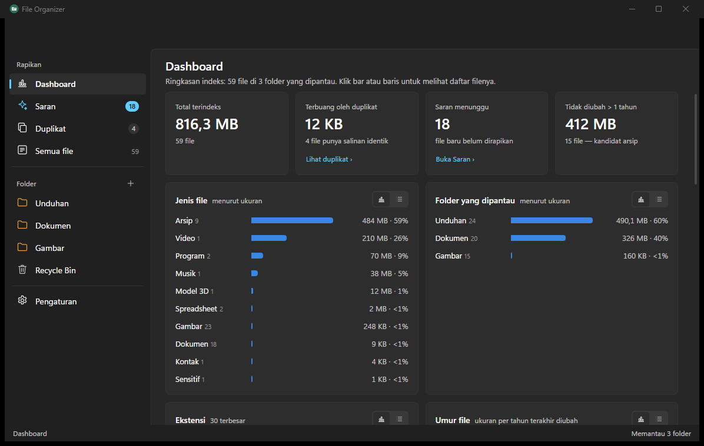
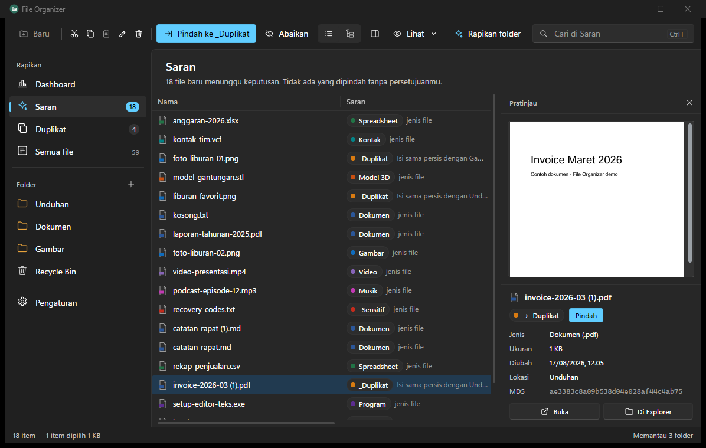
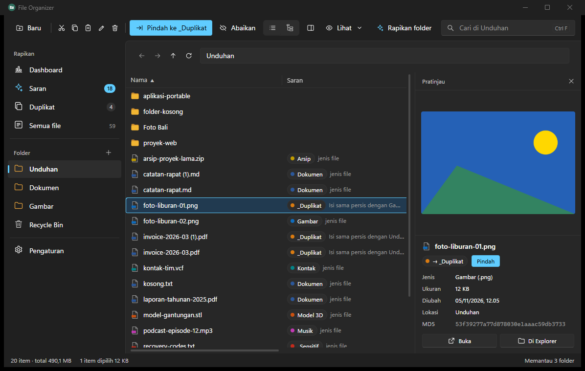
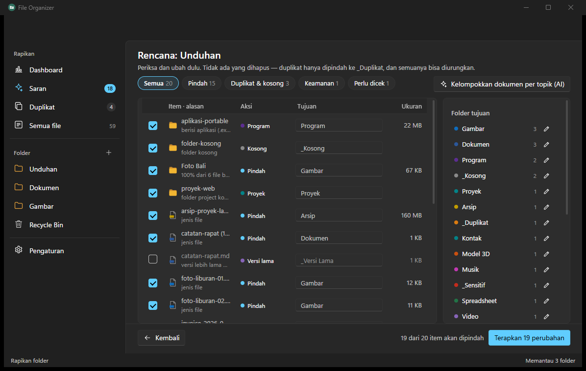
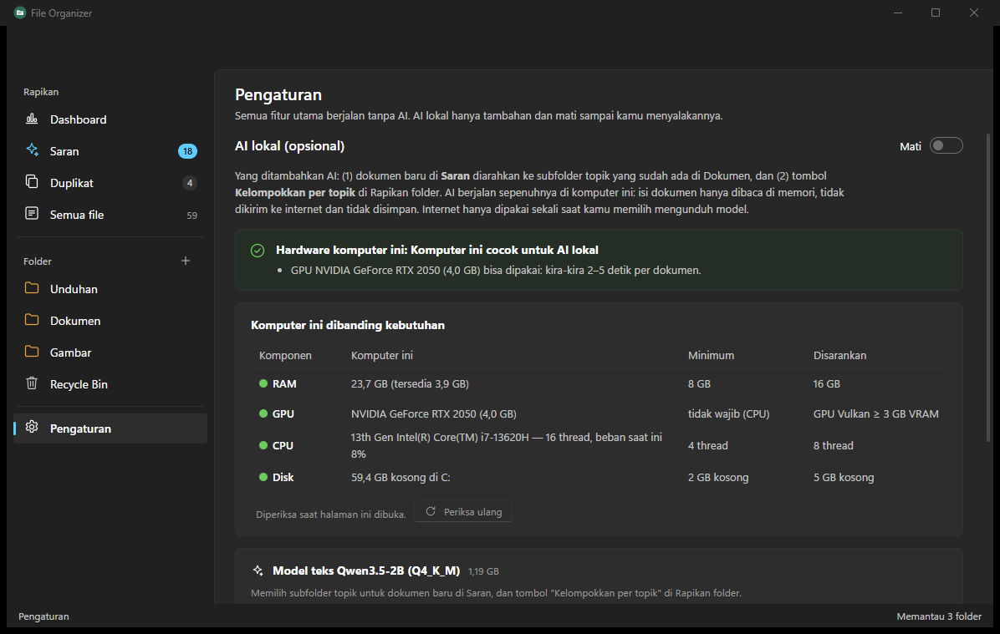

<div align="center">

# File Organizer

**A Windows desktop app that keeps your folders tidy — and never moves a file without asking.**

**English** · [Bahasa Indonesia](README.id.md)



</div>

File Organizer watches the folders you choose, suggests where new files belong, finds exact duplicates, shows where
your disk space goes, and turns a messy folder into an editable clean-up plan. Nothing moves until you approve it,
nothing is deleted behind your back, and every run can be undone.

Built with [Tauri 2](https://tauri.app) and Rust, with a dependency-free HTML/CSS/JS interface that follows the
Windows 11 look in light and dark mode. The interface is in Indonesian (Bahasa Indonesia).

## Highlights

- **Suggest, never surprise** — every move needs a click; nothing is overwritten; every batch can be undone.
- **Duplicates by content** — MD5 of every file, not just matching names.
- **Tidy a whole folder** — an editable plan with a live preview, applied as one undoable batch.
- **Explorer-like browsing** — list or tree, preview pane, cut/copy/paste with File Explorer, drag & drop,
  Recycle Bin, hidden items, folder sizes.
- **Dashboard** — where the space goes, by type, extension, folder and age, with drill-down lists.
- **Optional offline AI** — off by default; a hardware check tells you whether it is worth enabling.

## Screenshots

| Suggestions | Browsing with preview |
|---|---|
|  |  |
| **Tidy plan** | **Settings: optional AI** |
|  |  |

All screenshots are taken from generated demo data (see [Screenshots](#screenshots-and-demo-data)).

## Features

### Suggestions (Saran)
New loose files in the watched folders get a destination by type (Dokumen, Gambar, Spreadsheet, Arsip, Program,
Kode, Musik, Video, …). Secret-looking names (recovery codes, keys, `.env`, passwords) go to `_Sensitif`, and a file
whose content already exists elsewhere goes to `_Duplikat`. A Windows notification announces new suggestions.

### Watched folders
Start with Desktop, Downloads, Documents, Pictures, Music and Videos, then add your user folder, OneDrive, whole
drives or any folder with **+**. Plugged-in drives are detected and can be added in one click; an unplugged drive
keeps its index and refreshes when it comes back. System folders and hidden items are skipped.

### Browsing
Address bar with back/forward/up, list and tree views, sortable and resizable columns, background folder sizes
(sorting by size ranks folders by their real total), search by name or MD5, and a resizable preview pane for images,
PDF, audio, video, text, code and DOCX.

### File actions
Open, rename, new folder (opens in rename mode), delete to the Recycle Bin (undoable), cut/copy/paste through the
Windows clipboard, drag & drop inside the app, from the desktop and out to other apps, properties, and a Recycle Bin
view to restore or permanently delete.

### Tidy a folder (Rapikan folder)
1. Tick the folders whose content should be tidied (unticked subfolders keep their content).
2. Review the plan: files by type, code projects → `Proyek`, app folders → `Program`, folders that are mostly one type,
   duplicates → `_Duplikat`, empty items → `_Kosong`, secrets → `_Sensitif`, suspicious PHP → `_Karantina`, older
   versions → `_Versi Lama` (unticked by default), English category folders → Indonesian names.
3. Edit anything: tick/untick, type a destination (`Dokumen\Pajak`), bulk-change rows, rename a destination for all
   rows. The preview updates live.
4. Apply — nothing is deleted or overwritten, and the whole run can be undone.

### Dashboard
Indexed size, space wasted by duplicates, pending suggestions and files untouched for a year; file types, folders,
extensions and file age as a chart (size and share) or a sortable table. Click any bar or row to list those files
(every `.exe`, all videos, files from 2021, …). Plus the largest files, the most wasteful duplicates and one-click
clean-up suggestions.

### Optional local AI
Suggests topic subfolders for documents. It runs entirely on your computer (llama.cpp; GPU via Vulkan with CPU
fallback); document text is read in memory only. The settings page compares this computer (RAM, GPU/VRAM, CPU load,
free disk) with the requirements and gives advice; downloading the model (≈1.2 GB, pinned revision, SHA-256 verified,
resumable) is always your choice.

## Keyboard shortcuts

| Keys | Action | Keys | Action |
|---|---|---|---|
| Enter / double-click | Open | Ctrl+X / C / V | Cut / copy / paste |
| F2 | Rename | Ctrl+Z | Undo last move or delete |
| Del | Delete to Recycle Bin | Ctrl+Shift+N | New folder |
| Alt+Enter | Properties | Ctrl+Shift+C | Copy path |
| Alt+P | Preview pane | Ctrl+H | Show hidden items |
| Alt+← / → / ↑ | Back / forward / up | Ctrl+F, F5 | Search, refresh |

## Safety

- Suggestions only; every move needs a click.
- Never overwrites: a taken name becomes `name (1).ext`.
- Deletes only on an explicit Delete, to the Recycle Bin (undoable); permanent deletion always asks first.
- Every batch of moves is logged and can be undone.
- Hidden/system files, code projects and dependency folders (`node_modules`, `target`, …) are left alone.

## Requirements

| | Minimum | Recommended |
|---|---|---|
| OS | Windows 10/11 x64 | Windows 11 |
| Without AI | any machine that runs Windows 10/11 | — |
| AI: RAM | 8 GB | 16 GB |
| AI: GPU | not required (runs on CPU, slowly) | Vulkan GPU with ≥ 3 GB VRAM |
| AI: disk | 2 GB free | 5 GB free |

## Build from source

Prerequisites: Rust (stable), Visual Studio Build Tools (C++), WebView2 runtime (included in Windows 11).

```powershell
cd src-tauri
cargo test              # self-checks
cargo run               # development build (without the AI engine)
cargo build --release   # src-tauri\target\release\file-organizer.exe
```

With the AI engine (additionally needs the Vulkan SDK, LLVM/libclang and CMake):

```powershell
$env:VULKAN_SDK = 'C:\VulkanSDK\<version>'
$env:LIBCLANG_PATH = 'C:\Program Files\LLVM\bin'
cargo build --release --features local-llm
```

Installer: `cargo install tauri-cli --version "^2"`, then `cargo tauri build` (add `--features local-llm` for AI).
The model is never part of the build or the repository.

## Screenshots and demo data

`scripts/demo-data.ps1` creates a messy sample folder with made-up files; `scripts/screenshots.ps1` runs a debug
build on that data only (separate index, fixed watched folders) and regenerates `docs/screenshots/`. See
[CONTRIBUTING.md](CONTRIBUTING.md).

## Project structure

```
ui/            interface (index.html, app.css, app.js) — no bundler
src-tauri/     Rust backend: indexer, rules, plans, file operations, preview, dashboard, optional AI
scripts/       demo data and screenshot generation
docs/          architecture notes and screenshots
```

Details: [docs/ARCHITECTURE.md](docs/ARCHITECTURE.md).

## Documentation

- [CONTRIBUTING.md](CONTRIBUTING.md) — building, testing, pull requests
- [PRIVACY.md](PRIVACY.md) — what is stored, read and sent (in short: nothing leaves your computer)
- [SECURITY.md](SECURITY.md) — reporting vulnerabilities
- [CHANGELOG.md](CHANGELOG.md) — release notes

## License

Copyright © 2026 Danu-Nur and contributors.

File Organizer is free software: you can redistribute it and/or modify it under the terms of the
[GNU General Public License v3.0 or later](LICENSE). It is distributed in the hope that it will be useful, but
WITHOUT ANY WARRANTY.

The optional text model (Qwen3.5-2B, GGUF) is downloaded by the user from Hugging Face and has its own license.
